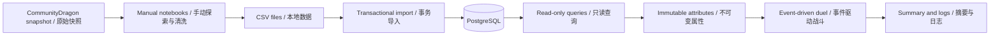
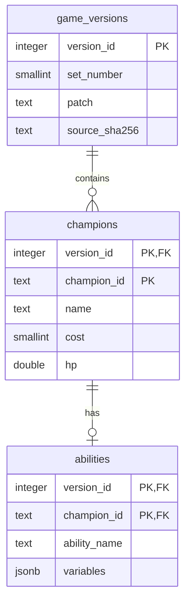

# Auto Battler Combat Balance Simulator

## TFT 战斗数值平衡模拟器

A personal Python project that turns versioned TFT data into a PostgreSQL-backed, testable combat simulation baseline. Monte Carlo analysis and interactive visualization are planned next.

一个从真实 TFT 数据出发，结合 **Python、PostgreSQL、数学建模与自动化测试** 的个人项目。目前已实现可复现的普通攻击 1v1 基线，正在逐步扩展统计分析能力。

**Current milestone / 当前进度：Phase 4 simplified combat baseline completed · 普通攻击基线已验收**

> This is a simplified research model, not a full TFT client reproduction. Model outputs are not ranked win rates or official Riot Games balance conclusions.
>
> 本项目是简化研究模型，不是完整游戏复刻。模型结果不等于真实排位胜率，也不代表 Riot Games 的官方平衡性结论。

## Project Status / 开发进度

| Phase | Scope / 内容 | Status / 状态 |
|---|---|---|
| 1 | Environment and project setup / 环境与项目初始化 | Complete / 已完成 |
| 2 | Versioned champion data / 真实英雄数据采集与整理 | Complete for the selected cohort / 当前样本已完成 |
| 3 | PostgreSQL schema, import and access / 数据库、导入与数据访问 | Simplified scope complete / 精简范围已完成 |
| 4 | Event-driven ordinary-attack duels / 事件驱动普通攻击战斗 | Baseline accepted / 基线已验收 |
| 5 | Reproducible randomness and selected skills / 可复现随机性与可核验技能 | Planned / 待开发 |
| 6–7 | Monte Carlo and balance analytics / 蒙特卡洛与平衡性分析 | Planned / 待开发 |
| 8 | Streamlit application / 交互应用 | Planned / 待开发 |
| 9–10 | Engineering and portfolio presentation / 工程完善与项目展示 | Planned / 待完善 |

**Last verified / 最近验证：106 tests passed with local database tests enabled.** The default offline run passes 90 tests and skips 16 database tests.

最近完整本地测试为 **106 项通过**；默认不连接数据库时为 **90 项通过、16 项跳过**。这些是本地执行记录，尚未配置 GitHub Actions CI。

## Key Features / 已实现功能

- **Traceable data / 可追溯数据** — A fixed Set/Patch snapshot, source URL, retrieval time and raw-file fingerprint. 固定版本并保留来源记录。
- **Relational storage / 关系型存储** — Version, champion and raw-ability tables with keys, constraints and indexes. 三张表管理版本、属性及技能原始参数。
- **Reusable data access / 可复用数据访问** — Transactional CSV import, read-only queries, a query CLI and explicit champion-maintenance CRUD. 支持导入、筛选和受控维护。
- **Independent battle state / 独立战斗状态** — Immutable source attributes and fresh state for every duel. 每场战斗独立，不覆盖数据库中的真实属性。
- **Event-driven combat / 事件驱动战斗** — Fixed-rate attacks, simultaneous batches, death, double knockout and timeout draws. 支持完整普通攻击流程。
- **Structured logs / 结构化日志** — Timestamps, actors, damage, remaining HP and initial mana snapshots. 可在 Notebook 中查看明细。
- **Automated tests / 自动化测试** — Offline tests and opt-in local PostgreSQL integration tests. 验证数学模型、状态边界与数据库行为。

Skills, passives, critical strikes, Monte Carlo batches, balance charts and Streamlit are **not implemented yet**. Equipment, trait/Headliner bonuses and star scaling remain deferred.

**尚未实现：**技能执行、被动、暴击、批量蒙特卡洛、平衡分析图表及 Streamlit。装备、羁绊、赛季之星与升星计算暂缓。

## Research Questions / 研究问题

The following questions guide future experiments; they are not claims of completed analysis.

以下问题用于指导后续实验，目前尚未形成研究结论：

1. How does performance vary across costs under standardized matchups? 在控制条件的对战中，不同费用英雄表现如何？
2. How sensitive are outcomes to HP, AD, attack speed and resistances? 属性变化对模型结果有多大影响？
3. Do equipment and base stats interact? 装备与基础属性是否存在协同效应？此项已暂缓。
4. Can reproducible simulations identify unusual scenario-specific outcomes? 可复现模拟能否发现特定情境中的异常表现？
5. Can controlled numerical changes move outcomes toward an explicit target? 独立数值实验能否使表现接近设定目标？

## Architecture / 项目架构



```text
tft-balance-simulator/
├── src/tft_simulator/
│   ├── config.py          # Environment configuration / 环境配置
│   ├── database/          # Import, queries and maintenance / 数据访问
│   ├── models/            # Source attributes and battle state / 属性与状态
│   └── combat/            # Damage, timing and event engine / 战斗模型
├── notebooks/             # Four author-run learning notebooks / 手动运行的学习笔记
├── sql/                   # Schema and example queries / 建表与查询
├── tests/                 # Offline and local database tests / 自动化测试
├── docs/                  # Sources, assumptions and phase records / 设计与阶段文档
├── data/                  # Local raw/processed data, Git-ignored / 本地数据
├── app/                   # Reserved for Streamlit / 后续应用
└── reports/figures/       # Reserved for analysis figures / 后续图表
```

## Technology Stack / 技术栈

| Component / 组件 | Current choice / 当前使用 |
|---|---|
| Language / 语言 | Python **3.13.16** |
| Database / 数据库 | PostgreSQL **18.6** |
| Database driver / 驱动 | psycopg 3 |
| Data exploration / 数据探索 | pandas, NumPy, Jupyter / ipykernel |
| Configuration / 配置 | Environment variables + python-dotenv |
| Testing / 测试 | pytest |
| Development / 开发 | Windows, PowerShell, VS Code, DBeaver, Git |

Python 3.13.16 is the current exact test target. Streamlit and Monte Carlo functionality are future work, not current stack features.

当前测试精确要求 Python 3.13.16；不要因为项目规划中出现 Streamlit 或 Monte Carlo，就认为这些功能已经可用。

## Data Sources / 数据来源

**Selected experiment / 当前实验版本：Set 10 — Remix Rumble · Patch 14.1 · English data (`en_us`).**

| Source / 来源 | Purpose / 用途 |
|---|---|
| [Riot TFT developer documentation](https://developer.riotgames.com/docs/tft) | Official API/static-data context / 官方数据接口背景 |
| [CommunityDragon 14.1 TFT JSON](https://raw.communitydragon.org/14.1/cdragon/tft/en_us.json) | Primary project input for champion attributes and raw parameters / 本项目属性与参数输入 |
| [Riot patch 14.1 notes](https://teamfighttactics.leagueoflegends.com/en-us/news/game-updates/teamfight-tactics-patch-14-1-notes/) | Cross-check published changes / 核对公开数值变动 |
| [CommunityDragon extraction documentation](https://github.com/CommunityDragon/Docs/blob/master/assets.md#tft-and-arena-data) | Explain community-generated JSON provenance / 说明社区提取来源 |

CommunityDragon is a community extraction source, not a Riot-authored combat-engine specification. The cohort contains **15 champions, three per cost**, and 15 raw ability records. It is purposively selected, not representative of the whole set.

CommunityDragon JSON 由社区从 Riot 文件整理生成，并非官方完整战斗规则。本项目选择 **15 名英雄，1–5 费各 3 名**，以及对应的 15 条技能归档，不能据此直接推断整个赛季的平衡性。

See [source notes](docs/phase2-data-sources.md), [cohort selection](docs/phase2-cohort.md) and [field dictionary](docs/champion-data-dictionary.md).

## Database Schema / 数据库结构



Version provenance is stored once. Composite keys prevent cross-version identity collisions. Raw skill parameters use JSONB; storing them does not mean their execution has been implemented.

版本来源集中保存，联合主键区分不同版本的同一英雄。技能参数以 JSONB 保存；**参数已入库不等于技能已实现**。当前只保存一份源属性记录，不推导星级属性。

Design: [database schema](docs/database-schema.md) · SQL: [schema.sql](sql/schema.sql) · Access layer: [CRUD](docs/database-crud.md).

## Installation / 安装

The commands below target Windows PowerShell and an existing Python installation. Open the cloned project folder in VS Code first.

以下命令适用于 Windows PowerShell。先在 VS Code 中打开项目目录，使用已安装的 Python；已有 `.venv` 时无需重复创建。

```powershell
py -3.13 -c "import sys; print(sys.version)"
if (!(Test-Path -LiteralPath .venv)) { py -3.13 -m venv .venv }
.\.venv\Scripts\python.exe -m pip install -r requirements-lock.txt
.\.venv\Scripts\python.exe -m pip install --no-deps -e .
```

`requirements-lock.txt` records the validated Windows environment. Alternatively, resolve the dependency groups from `pyproject.toml`:

依赖快照对应已验证的 Windows 环境。若希望重新解析依赖，可改用：

```powershell
.\.venv\Scripts\python.exe -m pip install -e ".[dev,notebook,analysis]"
```

Select `.venv\Scripts\python.exe` as the interpreter and Notebook kernel. Direct interpreter commands do not require activation or execution-policy changes.

选择该虚拟环境作为解释器和 Notebook 内核。上述写法无需激活虚拟环境，也无需修改 PowerShell 执行策略。

## Database Setup / 数据库准备

1. Create a local `.env` only if absent. 仅在不存在时复制配置模板：

   ```powershell
   if (!(Test-Path -LiteralPath .env)) { Copy-Item -LiteralPath .env.example -Destination .env }
   code .env
   ```

2. Fill in the password locally. 在本地填写 `DB_PASSWORD`；不要提交真实密码。配置默认连接 `localhost:5432` 的 `tft_balance_simulator` 数据库，已有环境变量优先于 `.env`。
3. In DBeaver, check whether the database exists. 在 DBeaver 中连接维护库 `postgres`，先确认目标库是否存在；只有不存在时才执行 [create_database.sql](sql/create_database.sql)，并开启自动提交。
4. On a **fresh** target database, run [schema.sql](sql/schema.sql) once. 在空的目标库中执行建表脚本；已有三张表时不要重复建表。
5. Acquire/clean source data manually, then use the documented importer. 手动获取并清洗数据后，按 [import guide](docs/data-import.md) 导入。示例中的文件名需要替换成你自己的导出文件名。

Validate the configured target / 验证连接：

```powershell
.\.venv\Scripts\python.exe -m tft_simulator.environment
```

## Usage / 使用示例

### Query PostgreSQL / 查询数据库

```powershell
.\.venv\Scripts\python.exe -m tft_simulator.database.query versions
.\.venv\Scripts\python.exe -m tft_simulator.database.query counts --version-id 1
.\.venv\Scripts\python.exe -m tft_simulator.database.query list --version-id 1 --cost 2
.\.venv\Scripts\python.exe -m tft_simulator.database.query show --version-id 1 --champion-id TFT10_Annie
```

`version_id=1` refers to the documented local import, not Set 1 or a star level. Check `versions` first when using another database.

`version_id=1` 是本项目当前导入记录的数据库编号，不是赛季或星级；其他数据库请先查询版本列表。

### Explore and simulate / 探索与模拟

The author manually maintains and runs these notebooks. Run them in order using the project kernel:

Notebook 由作者手动维护和运行，建议使用项目内核按顺序执行：

1. [Data acquisition / 数据获取](notebooks/1.%20data%20acquisition.ipynb)
2. [Data cleaning / 数据整理](notebooks/2.%20data%20cleaning.ipynb)
3. [Database queries / 数据库查询](notebooks/3.%20database%20queries.ipynb)
4. [Basic combat / 普通攻击战斗](notebooks/4.%20basic%20combat.ipynb)

Source-backed runs require your local data and database. Some cells refer to saved snapshot filenames that must be adjusted to your own acquisition output. There is **no one-command end-to-end reproduction workflow yet**.

真实英雄实验依赖本地数据和数据库；部分单元格中的快照文件名需要按实际下载结果调整。目前**尚未实现一键复现全流程**。

### Example result / 已验证的示例结果

Annie vs. Olaf, under this ordinary-attack-only model:

以下结果仅对应本模型中不含技能和被动的 Annie 对 Olaf：

| Time limit / 时长上限 | Outcome / 结果 | Duration / 实际时长 | Remaining HP: Annie / Olaf |
|---|---|---|---|
| 60 seconds / 秒 | Olaf wins / Olaf 获胜 | ~15.3846 seconds / 秒 | 0 / ~353.7037 |
| 5 seconds / 秒 | Timeout draw / 超时平局 | 5 seconds / 秒 | 312.5 / ~561.1111 |

The full duel produces 23 structured event records. This comparison does not establish which complete champion is stronger in real TFT.

完整示例产生 23 条事件日志；该结果不能判断真实游戏中包含技能与被动的英雄整体强弱。

## Combat Methodology / 战斗模型

- **Event-driven / 事件驱动：** advance directly to the next attack time. 直接跳到下一次攻击，不逐毫秒循环。
- **Timing / 时序：** the first attack occurs after one full interval; later attacks use absolute attack-number-based times. 第一击等待完整间隔，后续按序号排期。
- **Simultaneous events / 同时事件：** exact matching timestamps form a batch; determine attacks before applying damage and death. 同批攻击先确定，再结算，允许双杀。
- **State / 状态：** create new state for every duel; source attributes remain unchanged. 每场使用独立状态，不写回原始数据。
- **Termination / 结束：** stop on death; surviving sides at the deadline draw. 死亡结束，到时双方仍存活则平局，不比较剩余HP判胜。
- **Logging / 日志：** record raw damage, post-resistance damage and actual HP removed separately. 区分原始伤害、抗性后伤害与实际扣血。

Rows in the same attack batch show the same post-batch HP snapshot. Mana is initialized and logged but does not increase or trigger skills.

同批日志显示相同的结算后生命值快照。法力目前仅初始化和记录，不获取法力或触发技能。

## Mathematical Models / 数学模型

For nonnegative resistance, the provisional model uses:

非负抗性使用以下暂定规则：

```text
D = D0 × 100 / (100 + R)
```

`D0` is raw damage, `R` is armor for physical damage or magic resistance for magic damage, and `D` is post-resistance damage. For `D0=100` and `R=100`, the result is `50`.

`D0` 为原始伤害，`R` 为对应抗性，`D` 为抗性计算后伤害。例如 100 点伤害对 100 点抗性，结果为 50。

```python
from tft_simulator.combat import physical_damage

# 人工数学例子，不代表某名英雄的完整技能或攻击。
print(physical_damage(100.0, armor=100.0))  # 50.0
```

Negative resistance has a separately documented provisional branch. True damage bypasses the two resistance terms in this model. Internal values use floats without per-hit integer rounding.

负抗性采用另行记录的暂定分支；真实伤害在当前模型中跳过抗性。内部保留浮点精度，不逐击取整。

**These formulas, attack-speed bounds and exact action timing have not been fully verified against Patch 14.1 client behavior. Tests validate the declared model, not game fidelity.**

**上述公式、游戏攻速边界与精确动作时序尚未完成 Patch 14.1 客户端核验。测试通过证明代码符合已声明规则，不证明它等同真实游戏。**

See [damage assumptions](docs/combat-mechanics.md), [timing rules](docs/attack-timing.md), and [duel specification](docs/basic-duel.md).

## Testing / 测试

Offline / 默认离线测试：

```powershell
.\.venv\Scripts\python.exe -m pytest -q
```

Expected / 预期：**90 passed, 16 skipped**.

Full local suite, after PostgreSQL setup and source import / 完成本地数据库与数据导入后：

```powershell
$env:TFT_TEST_DATABASE = '1'
.\.venv\Scripts\python.exe -m pytest -q
Remove-Item Env:TFT_TEST_DATABASE
```

Last verified / 最近验证：**106 passed**. Database-maintenance tests operate on `TEST_ONLY_` fixtures inside forced-rollback transactions; the real cohort remains unchanged.

数据库维护测试只操作事务中的人工测试记录，并强制回滚，不修改正式英雄数据。尚未配置自动CI，不能把本地通过记录当作GitHub Actions状态。

## Limitations and Roadmap / 限制与后续计划

The model currently assumes fixed stats, constant attack speed and both units always being in attack range. It omits skills, passives, critical strikes, movement, cast timing and projectile travel. Source star-level semantics remain unresolved; no higher-star values are generated. Deterministic repetitions add no Monte Carlo information.

当前假设固定属性、固定攻速和始终在射程内；不模拟技能、被动、暴击、移动、施法时序与弹道。源属性的星级语义仍待核验，不生成高星数据。当前无随机机制，重复同一战斗不会增加蒙特卡洛信息。

Next, subject to phase-by-phase approval / 后续按阶段推进：

- Reproducible randomness and selected, verifiable skills / 可复现随机性与可核验技能。
- Monte Carlo summaries and confidence intervals / 批量模拟、统计摘要与置信区间。
- Matchup matrices and controlled sensitivity experiments / 对战矩阵与受控敏感性分析。
- Streamlit and automated CI / 交互应用与自动化质量流程。

Equipment remains deferred. None of these roadmap items should be read as an implemented feature.

装备继续暂缓；以上均为计划，不是已完成功能。

## Documentation / 进一步阅读

- [Data sources / 数据来源](docs/phase2-data-sources.md)
- [Field dictionary / 字段字典](docs/champion-data-dictionary.md)
- [Database access / 数据访问](docs/database-queries.md)
- [Model scope / 模型范围](docs/model-scope.md)
- [Phase 4 acceptance / 普通攻击基线验收](docs/phase4-validation.md)
- [GitHub workflow / 上传与更新](docs/github-guide.md)

## Security and Attribution / 安全与归属

This is an unofficial personal research project. TFT game data remains Riot Games' intellectual property. Riot Games does not endorse or sponsor this project. A future code license does not relicense third-party data or assets.

本项目是非官方个人研究项目。TFT 游戏数据与相关资产的权利归 Riot Games 等对应权利方所有；本项目不受 Riot Games 背书或赞助。未来如为原创代码添加许可证，不代表第三方数据和资产一并重新授权。
