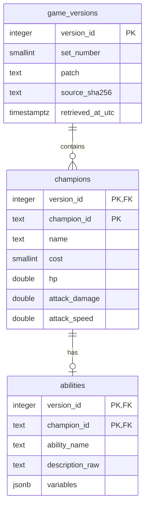

# Phase 3: initial relational schema

Status: initial schema creation is verified on 2026-10-28. Read-only inspection found all three intended tables in `tft_balance_simulator`, with the expected column types, keys, checks, and indexes; each table has zero rows. The maintenance database `postgres` has no user tables. The user had successfully created the schema; the agent did not recreate it or modify database data.

DBeaver was also verified directly: a fresh SQL editor connected to `tft_balance_simulator` successfully ran a read-only query returning all three table names and their zero counts. Refreshing the Tables node with F5 revealed the three tables in the navigator. The old editor showed `there is no transaction in progress` warnings after ROLLBACK; these warnings do not mean schema creation failed. Two simultaneous database connections do not themselves cause a conflict. Do not rerun schema.sql on the existing schema.

## Scope

Three tables store the current unmodified source data. Champion identity and stats are kept together because there is only one raw stat record per champion/version; no star-specific rows are generated. Split champion_stats into a separate relation only when multiple verified star/configuration records are needed. No equipment tables or simulated results exist yet.

## Keys and constraints

- `game_versions.version_id`: generated integer identity. One snapshot is uniquely identified by `(set_number, patch, source_sha256)`, allowing distinct archive snapshots of the same patch without conflating them.
- `champions`: composite primary key `(version_id, champion_id)`. The same source champion ID may exist in several versions.
- `abilities`: the same composite key, also a foreign key to champions. A skill cannot reference a champion from a different version or a nonexistent champion. This initial dataset has one ability container per champion, including passives/complex text in that container.
- Version provenance lives in game_versions instead of being duplicated in every champion/ability row.
- Default foreign-key deletion behavior blocks deleting referenced parents. No cascading deletes are defined.
- Cost 1–5 and nonmissing numeric stats describe the current curated cohort. Future datasets with other costs or missing stats require an intentional schema change, not invented replacements.
- `DOUBLE PRECISION` corresponds to the source's floating-point numeric values. No rounding is applied. Ingestion validation will reject nonfinite values before import.
- `traits TEXT[]` stores raw labels as an array. No trait effects are applied; a separate traits relation can be added if trait-level queries become necessary.
- `variables JSONB` stores the parameter array structurally. JSONB preserves its values and array order, but not the exact original whitespace or object-key order; the raw JSON snapshot remains the byte-level source record.
- `patch` is text, not a decimal number. `TIMESTAMPTZ` stores an absolute retrieval instant; display timezone depends on session configuration. Use the source manifest's time, not the import time.
- `release_date` is nullable because article publication and archive modification time are not reliable substitutes for release date.
- No star_level is asserted. Skill damage types and parameter-index semantics are not guessed.

## Run in DBeaver

1. Select a connection whose database is `tft_balance_simulator` (not the maintenance database `postgres`). Confirm with `SELECT current_database();`.
2. Open `sql/schema.sql` and execute the whole script (Alt+X by default). It creates three tables and one additional index inside a transaction.
3. If anything fails, stop and report the error. If DBeaver leaves the transaction aborted, run `ROLLBACK;` before retrying. Do not drop existing tables to rerun a successful script.
4. Refresh `Schemas > public > Tables` (usually F5).
5. Run `sql/queries/01_verify_schema.sql`. Expect three table names with zero rows each.

The script intentionally has no `IF NOT EXISTS`, so a repeated execution reports a collision instead of hiding differences in an existing schema. It contains no CREATE DATABASE, DROP, TRUNCATE, or data replacement. Keep the SQL file under Git to reproduce the structure in a fresh database.

## Next step

Schema creation, DBeaver visibility, CSV import, reusable queries, and maintenance CRUD have been verified. The database contains 1 version, 15 champions, and 15 abilities; all 29 tests pass with local integration enabled. The reduced Phase 3 has passed; see `phase3-validation.md`. Phase 4 awaits user confirmation.
